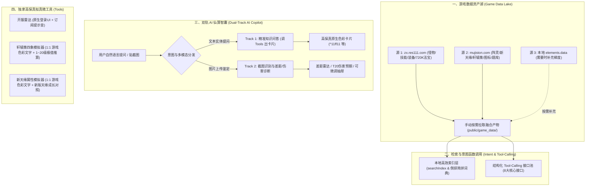

# 诛仙3 战斗实验室 · 2026 终极架构与数据湖驱动升级方案

## Goal Description

将「诛仙3 副本战斗实验室」升级为 **「2026 新一代数据湖驱动、双轨 AI 仙算智囊、高保真拟真微工具合一的综合决策工作台」**。

核心解决传统游戏站数据生硬杂乱、用户查找门槛高的问题，打造两大差异化杀手级体验：
1. **实体与知识问答流（Track 1）**：基于按需抓取融合的三源游戏数据湖，AI 识别意图后直接调度结构化接口，0 幻觉直给原色数据卡片；
2. **多模态截图诊断流（Track 2）**：针对玩家最常见的游戏截图（轩辕策/新天缘/装备/C键面板），通过免费视觉识别池提取数值，实现「差距鉴定」与「直接打桩测算」，附带数值一键微调抽屉与计算器深链闭环。

---

## User Review Required

> [!IMPORTANT]
> **已确认：识图容错微调抽屉（Quick Edit Drawer）**：
> 视觉大模型识别出数值后，在诊断卡片旁内嵌「键值微调框」，用户可单点秒改数字，实时联动重新触发极值比对与伤害测算，容错体验最佳。

> [!IMPORTANT]
> **已确认：数据湖维护策略**：
> 手动按需编写专用脚本从两个网站进行数据拉取融合；本地游戏 client/datas 目录仅在补充深层缺失数据时执行。

> [!TIP]
> **已确认：免 Key 零成本视觉与大模型架构**：
> 采用 Cloudflare Pages 内置的免费 Workers AI（Llama-3.2-Vision + Qwen2.5/DeepSeek-R1，每日 10,000 Neurons 免费额度）作为 L2 层，L1 本地意图直出（0ms/0成本），额度耗尽优雅降级回 L1。

---

## Proposed Changes



---

### [Component 1: 数据湖按需拉取与融合脚本]

#### [NEW] `scripts/data_lake/fetch_curated_data.ts`
- 按需从 `zx.res111.com` 抓取并清洗怪物属性、法宝图鉴（720KB 精细数据）、主流装备（修武/昭武/彰武/神隐）；
- 按需从 `mujiston.com` 提取阵灵卡牌、新天缘属性对照、轩辕策成长表、战区服务器列表；
- 产出分块 JSON 文件存放于 `web_app/public/game_data/`：
  - `game_data/fabao_curated.json`
  - `game_data/equip_curated.json`
  - `game_data/xyc_rules.json`
  - `game_data/tianyuan_rules.json`
  - `game_data/server_list.json`

#### [MODIFY] `web_app/src/services/DataService.ts`
- 新增对上述分块数据的异步按需加载与类型定义。

---

### [Component 2: 游戏原生色彩引擎与排版组件]

#### [NEW] `web_app/src/components/ui/GameColorText.tsx`
- 精确解析 `^11ff11`（荧光绿）、`^ffcb4a`（金黄）、`^96f5ff`（冰蓝）、`^ffffff`（纯白）等游戏色彩控制符；
- 1:1 呈现游戏原版暗黑 Tooltip、字号与字符间距排版。

---

### [Component 3: 精选动态图鉴]

#### [NEW] `web_app/src/components/compendium/FabaoCompendiumView.tsx`
- 主流打本与实用法宝，支持普通 / 承 / 真形态一键 Tab 切换，1~5 阶动态滑块，高亮破防与增伤标签。

#### [NEW] `web_app/src/components/compendium/EquipCompendiumView.tsx`
- 精选修武、昭武、彰武、神隐 4 套主流装备，支持 `+0` 至 `+15` 炼器滑块与蕴灵阶数动态联动计算。

---

### [Component 4: 独家高保真微工具]

#### [NEW] `web_app/src/components/tools/ServerRadarView.tsx`
- 1:1 游戏登录选服 UI，战区分类、个人关注服务器订阅（LocalStorage）、开服提示音。

#### [NEW] `web_app/src/components/tools/XuanYuanCeView.tsx`
- 1:1 游戏色彩文字，青龙/白虎/朱雀/玄武，1~20 级成长曲线测算与极值比对。

#### [NEW] `web_app/src/components/tools/TianYuanView.tsx`
- 1:1 游戏色彩文字，新版天缘成长洗练与极限属性对照。

---

### [Component 5: 双轨 AI 仙算与视觉识图诊断引擎]

#### [NEW] `web_app/src/services/ai/IntentRouter.ts`
- **L1 本地规则引擎**：简拼与关键词秒级匹配，直接调用 `AiTools.ts` 生成卡片；
- **L2 Cloudflare Workers AI**：绑定免费 `@cf/meta/llama-3.2-11b-vision-instruct` 与 `@cf/deepseek-ai/deepseek-r1-distill-qwen-32b`；
- **L3 优雅降级**：额度达到上限时自动无缝回退至 L1。

#### [NEW] `web_app/src/components/ai/CopilotDrawer.tsx` 与 `OcrCorrectionPanel.tsx`
- 全站悬浮 Copilot 抽屉；
- 截图上传与多模态识别；
- 场景 1（细节与轩辕策鉴定）与 场景 2（C键面板 -> T20打桩伤害测算）；
- **内嵌数值一键微调抽屉**，支持实时单点修正并即时重新诊断。

#### [MODIFY] `web_app/src/components/home/HomePage.tsx`
- 首页搜索框升级为「智能搜索 + 问答」双模中心；
- 置顶 3~4 个典型问答与诊断动态示例卡片。

---

## Verification Plan

### Automated Tests
```bash
cd D:\工作\ww\personal_work\new_zx_calc_noactcode_agent\web_app
npm run build
```
- 验证所有新增 TypeScript 类型无报错，Vite 顺利打包。

### Manual Verification
1. **数据拉取与清洗验证**：
   - 运行数据拉取脚本，验证生成的各 JSON 文件结构完整、数值准确。
2. **游戏色彩保真验证**：
   - 查看法宝与技能描述，确认文字颜色与游戏客户端 1:1 吻合。
3. **动态阶数与炼器验证**：
   - 拖动装备炼器滑块（0~+15），验证属性即时变动；
   - 切换法宝阶数（1~5阶），验证技能数据动态切换。
4. **识图诊断与微调抽屉**：
   - 上传轩辕策/属性图，验证数值识别、差距评级与伤害测算；
   - 在微调面板修改数值，验证诊断报告瞬间联动刷新。
5. **微工具交互与音效**：
   - 访问开服雷达，测试收藏服务器与开服提示音。
