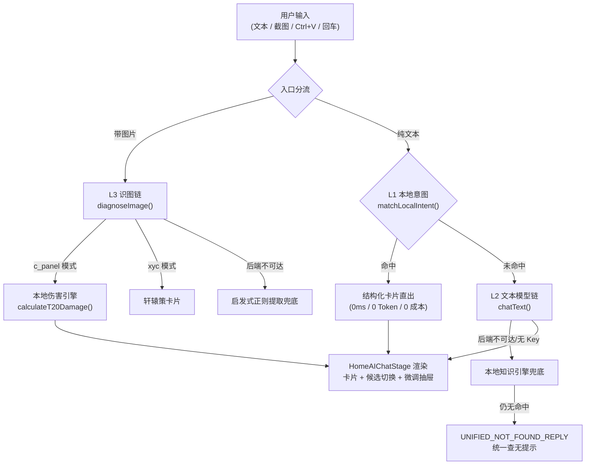

# 天书万象 AI 对话全链路说明书与意图匹配维护指南

> 文档版本：V1.0
> 日期：2026-10-15
> 基线代码：commit `75c1454`（本地库 HEAD；`a3b00c3` 留言板极简化、`75c1454` sync 30s 冷却 + cloudPosts≤1 门禁均已提交。本文档所有行号锚点已对 `75c1454` 复核）
> 用途：记录「用户输入 → 输出」完整链路的每一步实际实现；作为后续**针对用户输入内容变化持续调整匹配规则**的唯一事实来源
> 范围声明：本期唯一工作域为 **L1 本地意图匹配**（第六、七节为提案，第八节为前瞻约束仅记录不实施）
> 关联文档：
> - `doc/诛仙3_AI大模型战术工作台与ChatGPT双轨架构设计方案.md`（目标态设计方案，非实链）
> - `doc/2026_ai_copilot_and_tools_upgrade_plan.md`（历史升级提案）
> - `doc/部署noactcode_agent到Cloudflare指南.md`（部署/域名；本文档第四章补充 AI 运行时绑定）

---

## 一、总览：一条主链 + 两条降级链



| 层 | 位置 | 成本 | 说明 |
|---|---|---|---|
| L1 本地意图 | `web_app/src/services/CopilotService.ts` → `matchLocalIntent()` | 0 Token | 关键词 + 实体槽位匹配，直接返回 `CopilotMessage`（含 cardType/cardData） |
| L2 文本模型 | `CopilotService.chatText()` → `functions/api/copilot/chat.ts` | 按 Key | 三级模型池 + 服务端兜底文案 + 前端降级 |
| L3 视觉模型 | `CopilotService.diagnoseImage()` → `functions/api/copilot/vision.ts` | 按 Key | 三级视觉模型池 + 兜底模板 + 启发式提取 |
| 数据底座 | `web_app/src/services/DataService.ts` + `web_app/public/game_data/*.json` | — | 按需 fetch + 主页预热 |

**核心编排在 `web_app/src/components/home/HomePage.tsx`**：`handleStartAiChat()`（首轮，第 130 行起）与 `handleFollowUpMessage()`（后续轮，第 235 行起）两个函数结构对称——先判有无图片，再走 L1，L1 落空才走 L2。

---

## 二、逐步链路详解

### S0 输入入口（所有输入的收口点）

| 入口 | 位置 | 行为 |
|---|---|---|
| 主页大输入框 | `HomePage.tsx` 第 501-534 行 | 回车/发送按钮 → `handleStartAiChat(query, attachedImage)` |
| 对话流底部输入框 | `HomeAIChatStage.tsx` 第 905-924 行 | → `onSendMessage` → `handleFollowUpMessage()` |
| 全局 Ctrl+V 粘贴截图 | 两个组件各有一个 paste 监听（HomePage 第 57 行、HomeAIChatStage 第 108 行） | FileReader 读 base64 dataURL 存入 `attachedImage` / `selectedImage` |
| + 号菜单选文件 | `handleFileSelect` | 同上 |
| 主页快捷药丸 | `HomePage.tsx` 第 541-579 行 | 等价于替用户输入 `'昭武'` / `'技能'` / `'计算实战战力'` / `'开服雷达'` |
| Header 自定义事件 | `open-zx-copilot` / `open-zx-workspace`（HomePage 第 102-127 行监听） | 外部入口直接带 prompt 触发 |
| 卡片内回点 | `SkillDetailCard` 的 `onSelectSkillName` | 把技能名当新输入再发一次 |

> 维护提示：所有新输入入口最终都应汇聚到 `handleStartAiChat` / `handleFollowUpMessage`，不要另起链路。

### S1 分流：有图走 L3，无图走 L1

`HomePage.tsx` 第 155 行 `if (img)`：
- **有图**：直接进 `diagnoseImage(img, text)`，**跳过 L1**（文本意图不参与识图分支）；
- **无图**：先 `matchLocalIntent(text)`，返回非 null 即渲染卡片并结束；返回 null 才进 `chatText(text, history)`。
- 多轮对话时 L2 会带 `chatMessages.slice(-4)` 历史（后端再截 `slice(-6)`）。

### S2 L1 本地意图匹配（`matchLocalIntent`，CopilotService.ts 第 346 行起）

**这是后续"输入变化匹配"的主战场**。匹配顺序即优先级，从高到低：

| 序 | 意图 | 代码位置 | 触发方式 | 输出 cardType |
|---|---|---|---|---|
| 0 | 纯数字守卫 | 第 356 行 | `/^[+-]?\d+(?:\.\d+)?$/`（允许小数）直接返回查无提示，防脏技能名误伤 | —（纯文本） |
| 1 | 开服雷达 | 第 369 行 | 开服/服务器/测服/选服/战区/雷达 等 8 词 | `server` |
| 2 | 战力计算器 | 第 396 行 | 计算器/战力计算/秒伤/计算/测算 等 | `tool_card` |
| 3 | 副本训练场 | 第 428 行 | 训练场/打桩/木桩/技能循环/竞技场 等 | `tool_card` |
| 4 | 轩辕策 | 第 456 行 | 轩辕策/四象/青龙书…（**先排除**四象七/七杀，防劫持历练本） | `xyc_diag` |
| 5 | 天缘推算 | 第 486 行 | 天缘/须弥天缘/天命属性 | `tool_card` |
| 6 | 凝灵契 | 第 509 行 | 凝灵契/灵契/凝灵 | `tool_card` |
| 7 | 仙友留言板 | 第 531 行 | 留言/反馈/建议/捉虫/催更 | `tool_card` |
| 8 | 更新动态 | 第 554 行 | 更新/排期/changelog/新特性 | `tool_card` |
| 9 | 关于本站 | 第 580 行 | 关于/本站/初衷/作者/萝卜/天书万象 | `tool_card` |
| 10 | **副本/BOSS** | 第 677 行起 | 见下方四级词库 | `boss` / `boss_candidates` |
| 11 | **装备** | 第 960 行起 | 品质+部位+名称槽位 | `equip` / `equip_candidates` |
| 12 | **法宝** | 第 1188 行起 | 显式"法宝/特技"词或法宝名/特技名命中 | `fabao` / `fabao_candidates` |
| 13 | **技能** | 第 1302 行起 | 显式"技能/神通/天书"词或技能名命中 | `skill` / `skill_candidates` |
| 14 | 极致属性 | 第 1536 行 | 极致无视/极致减免/怪增/躲闪/天花板/上限 | `ceiling` |

**顺序敏感性（改动时务必保留）**：微工具意图（1-9）优先于一切实体匹配——否则"轩辕策四象"会被后面副本词库的"四象七"劫持、"计算"会被技能名吞掉。实体槽位提取（第 608 行）在微工具之后执行：按 `[\s,，+＋/、·\-_()（）]` 分词，提取品质（8 个：修武/昭武/彰武/神隐/神级/天命/至尊/混虚）、部位（15 个标准位 + 32 个别名，第 612-626 行）、职业（27 个，第 627-631 行）、强化等级（`+15`/`13阶`）。

**副本四级词库**（第 68-292 行，改动"副本别名"只动这里）：
1. `DUNGEON_DICTIONARY`（16 个精确副本，含 aliases，如 `t20`/`断浪t20`/`碎晶宫t20`）→ 单本全 BOSS 候选；
2. `DUNGEON_SERIES`（5 个多难度系列）→ 系列全 BOSS 候选；
3. `DUNGEON_CATEGORIES`（T本/团本/历练 3 大类）→ 每本取代表 BOSS；
4. BOSS 名模糊匹配（`mName === q` 或互含，第 703-714 行）→ 单个直出 / 多个跨难度候选。

判定优先级：单 BOSS 命中 > 多 BOSS 候选 > 具体副本 > 系列 > 大类 > 泛化词（"副本"/"boss"）。泛化意图补充条件：含"副本/boss/首领"且不含"装备"（第 723 行）。

**装备意图关键防误伤**（第 960-1187 行）：
- 含"技能"且无部位/品质且无"装备"→ 让位给技能意图（第 991-1001 行）；
- 纯品质大阶词（如只输"昭武"）不当单件装备直出（第 1054 行）；
- 同系列中间阶用 `collapseSeriesCandidates()` 聚合去重，只留最高阶做候选代表（第 1141 行）；
- 未指定职业时按主流职业优先级排候选（第 1125 行）。

**法宝意图关键防误伤**（第 1188-1301 行）：必须显式含"法宝/特技"或命中法宝名/特技名才触发；检索特效文本时剔除"影响技能"跨引用段（第 1254 行），防止法宝里枚举的全门派技能劫持普通技能检索。

**技能意图**（第 1302-1535 行）：显式类别词（技能/神通/天书/心法/造化/星宿/玄烛/赤乌）+ 剥离门派/阵营后的自由词做包含匹配；排除"触发技能/怪物技能"分组（第 1462 行）；裸输"技能"时展示各主流职业代表技能候选（第 1353 行）。

### S3 卡片渲染（`HomeAIChatStage.tsx` 第 307-840 行）

`cardType` 与渲染分支一一对应（**新增卡片类型必须同步三处**：`CopilotMessage.cardType` 联合类型第 28 行、本文件渲染分支、S2 里的 return）：

| cardType | 渲染组件 |
|---|---|
| `c_panel_diag` | 内嵌 T20 推演报告 + 8 项数值矩阵 + `InlineNumberRow` 微调抽屉（改数即重算）+ 带入推演 |
| `boss` / `boss_candidates` | `BossDetailCard` / `CandidateSelectorBar` + `BossDetailCard` |
| `skill` / `skill_candidates` | `SkillDetailCard` |
| `fabao` / `fabao_candidates` | `FabaoDetailCard` |
| `equip` / `equip_candidates` | `EquipDetailCard`（男女版按纯名去重，第 800-808 行） |
| `ceiling` / `server` / `xyc_diag` / `tool_card` | 轻量导航卡（点击开分屏工作区或跳路由） |

`workspaceMode` 命中即自动展开右侧分屏工作区（HomePage 第 198-204 行）。

### S4 L2 文本链（`chatText`，CopilotService.ts 第 1581 行起）

前端顺序：
1. `POST /api/copilot/chat`（带 prompt + history + 用户自定义 Key）；
2. **后端不可达或未返回 reply** → 客户端直连智谱 GLM-4-Flash（仅当用户自填 Key）；
3. 本地知识引擎（第 1633-1682 行，约 30 个关键词，分支：开服/训练场/天缘/留言/更新/关于/法宝/逐霜/青云/鬼王/破防伤害计算/配装——**末条含「装备/元婴/轩辕策」**）；
   > ⚠️ **掩盖风险**：「装备」「轩辕策」同时是 L1 的实体意图词。L1 漏匹配这类输入时会被本层泛型配装文案接住，**不会**进入 `UNIFIED_NOT_FOUND`——端到端看"有回复"会掩盖 L1 回归。夹具（第七章）必须直接断言 `matchLocalIntent` 的返回值，不能只断言最终文案；
4. `UNIFIED_NOT_FOUND_REPLY`（第 14 行，统一查无提示 + 检索示例）。

Pages Function（`functions/api/copilot/chat.ts`）模型优先级：

| 序 | 模型 | Key 来源 |
|---|---|---|
| 1 | 智谱 GLM-4-Flash | `customKeys.zhipuKey` → `env.ZHIPU_API_KEY` |
| 2 | 硅基流动 Qwen2.5-7B-Instruct | `customKeys.siliconflowKey` → `env.SILICONFLOW_API_KEY` |
| 3 | Cloudflare Workers AI `llama-3.1-8b-instruct` | `env.AI` 绑定 |
| 4 | 服务端兜底文案（嵌入 prompt 的策略库模板） | 无 |

系统提示词固定（第 36-47 行）：诛仙3 战术专家人设 + 禁用 LaTeX + 纯文本数值。**改人设/改文风只改这一段。**

### S5 L3 识图链（`diagnoseImage`，CopilotService.ts 第 1690 行起）

前端顺序：
1. `POST /api/copilot/vision`（base64 + prompt + Keys）；
2. 客户端直连智谱 GLM-4V-Flash（用户自填 Key）；
3. **启发式兜底**（第 1759 行起）：注意——此兜底解析的是**用户文本**里的数字（正则提 攻击/防御/气血/真气/无视/减免/怪增/爆伤/暴击/减暴），不是图片；职业取文本命中的 27 职业之一（默认逐霜，数组与 L1 的 `profs` 完全同源），阵营取佛/魔（默认仙）。**仅当后端 `/api/copilot/vision` 不可达时生效**（本地 dev 无此接口 mock、或线上 Functions 目录配置错误）——此时默认大攻 195000/防 96000/血 3800000；而**线上无 Key 的常见路径走的是 vision.ts 的 offline-preview 兜底，默认值另一套**（大攻 185000/防 95000/血 3500000，见坑 9）。

Pages Function（`functions/api/copilot/vision.ts`）模型优先级：GLM-4V-Flash → 硅基 Qwen2-VL-7B → Gemini-1.5-Flash → 服务端兜底模板（固定青云面板数值，provider 标记 `offline-preview`）。

`VISION_SYSTEM_PROMPT`（第 24-59 行）约定输出 JSON 结构：`{mode: c_panel|xyc|item|general, rawExplanation, cPanelData?, xycData?}`；`extractJson()`（第 251 行）兼容裸 JSON 和 ```json 代码块。**改识图字段只改这段 prompt + `ExtractedCPanel` 接口（CopilotService.ts 第 32 行）。**

### S6 识图后处理（`HomePage.tsx` 第 159-192 行）

- `mode === 'c_panel'` → `calculateT20Damage()`（CopilotService.ts 第 1806 行起）：面板映射 `CharacterAttributes`（最小攻 = 大攻×0.9）→ 取 T20 副本 → 按职业+阵营取技能 → `calculateDungeonPower()` → 无视减免系数修正（`clamp(ignore/130, 0.6, 1.6)`）→ 输出"XX 亿"；异常时落硬编码 18.65 亿；
- `mode === 'xyc'` → 轩辕策卡片（带 `?beast=&lvl=` 深链）；
- `item` / `general` 模式 → 纯文本说明（前端无专属卡片；`VISION_SYSTEM_PROMPT` 允许模型返回这两种模式，落入 else 分支）。

微调抽屉每改一个数都实时重跑 `calculateT20Damage`（HomeAIChatStage 第 313 行），"带入推演"把面板写进 `AppContext`（`updateCharacterClass` + `updateCharacterAttributes`）并展开计算器/训练场（第 180-211 行）。

### S7 数据底座（`DataService.ts`）

| 数据 | 文件 | 加载方式 |
|---|---|---|
| 职业/技能/副本/buff/rank/攻略 | `game_data/classes|skills|dungeons|dungeons_monsters|combat_buffs|rank_config|attribute_ceiling_guide|stat_source_lists.json` | `loadAllData()` 全量 |
| 装备/法宝/技能速查 | `game_data/equip_curated|fabao_curated|all_skills_curated_1~3.json` | 懒加载（Promise 缓存） |
| 轩辕策/天缘/服务器 | `game_data/xyc_rules|new_tianyuan_data|server_list.json` | 懒加载 |

主页挂载即 `preloadCopilotData()` 预热后五者（第 344 行）。脏数据过滤：`isValidSkill`（第 358 行，挡纯数字名/废弃测试名/无描述技能）、`isValidEquip`（第 383 行，挡测试道具/纯品质名/无属性装备）——**新增 curated 数据不显示时先查这两个函数**。

文本着色：`GameColorText` 组件解析 `^RRGGBB` 游戏原色码渲染（HomeAIChatStage 第 301 行）。

---

## 三、Cloudflare 运行时（实链依赖）

Functions 目录：仓库根 `functions/`（**唯一生效位置**，`web_app/functions/` 已于 862883d 删除）。

| 绑定/变量 | 用于 | 缺失时行为 |
|---|---|---|
| `GUESTBOOK`（KV） | 留言板 | 前端显示"离线缓存模式"，仅本地 localStorage |
| `ZHIPU_API_KEY` | L2/L3 优先级 1 | 降级下一级 |
| `SILICONFLOW_API_KEY` | L2/L3 优先级 2 | 降级下一级 |
| `GEMINI_API_KEY` | L3 优先级 3 | 降级兜底模板 |
| `AI`（Workers AI） | **仅 L2 优先级 3**（chat.ts 第 120 行使用；vision.ts 虽声明 `AI?: any` 但全程未调用——**识图没有 Workers AI 通道**） | L2 走兜底文案；L3 直接进 offline-preview |

用户还可在前端自填 Key（`CopilotService.getUserKeys()`，存 localStorage `zx_ai_copilot_custom_keys`），**优先级高于环境变量**。

---

## 四、维护速查表：用户输入变了，改哪里？

| 需求 | 改动位置 |
|---|---|
| 给现有意图加触发词 | 对应 `if (q.includes(...))` 块，CopilotService.ts 第 369-605 行（微工具）/ 第 68-292 行词库（副本） |
| 加一个新微工具意图 | ① S2 加一个 return 块（注意插在实体匹配之前）② `cardType` 联合类型加值 ③ HomeAIChatStage 加渲染分支 |
| 加副本/别名/系列/大类 | `DUNGEON_DICTIONARY` / `DUNGEON_SERIES` / `DUNGEON_CATEGORIES`（第 68-292 行），dungeonId 须与 `dungeons.json` 对齐 |
| 加新职业/新部位别名 | `profs` 数组（第 627 行）/ `slots` + `slotAliases`（第 612-626 行） |
| 改识图提取字段 | `ExtractedCPanel` 接口 + `vision.ts` 的 `VISION_SYSTEM_PROMPT` + HomeAIChatStage 的 c_panel 卡片三处同步 |
| 换 L2/L3 模型或加 Key 渠道 | `functions/api/copilot/chat.ts` / `vision.ts` 追加优先级块；前端 `UserCustomApiKeys` 接口同步 |
| 改 AI 人设/文风 | **四处同步**：`chat.ts` 第 36-47 行（后端 L2，线上主路径）、`CopilotService.ts` 第 1618 行（客户端 L2 直连，用户自填 Key 且后端不可达时生效）、`vision.ts` 第 24 行 `VISION_SYSTEM_PROMPT`（后端 L3，线上主路径）、`CopilotService.ts` 第 1733 行（客户端 L3 直连内联 prompt） |
| curated 数据查不到 | 先查 `isValidSkill` / `isValidEquip` 过滤，再查 `all_skills_curated_*.json` 分块是否含该条 |
| 新增卡片类型编译不报错但没渲染 | `cardType` 联合类型、S2 return、HomeAIChatStage 渲染分支三处漏一处（TS 不会报漏） |

---

## 五、已知边界与坑

1. **顺序即优先级**：S2 表中任何意图前移/插队都可能改变其他意图的命中结果；新增意图默认加在表格尾部（实体之后）最安全，除非有意抢占。
2. **L1 命中即终局**：L1 命中后不会再进 L2——想让某类输入改走大模型，只能让 L1 不命中（加排除条件）。接入 LLM 的路由重构见第八章。
3. **纯数字/极短输入**有守卫与 `q.length >= 2` 双条件，防脏数据误伤；新增匹配注意保留长度下限。
4. **识图兜底不识别图片**：全链路无 Key 时，识图结果是按用户文本生成的模板数值，UI 已提示"识图功能受限使用"。
5. **history 双层截断**：前端 `slice(-4)`、后端 `slice(-6)`，长上下文会丢早期轮次。
6. **本地 tsc 不覆盖 `functions/`**：Functions 仅 Cloudflare 构建时检查类型，本地改动需自查。
7. **留言板**已独立为 KV 持久化链路（`functions/api/guestbook.ts`），不在本 AI 链内；其维护见当次审查记录。
8. **极致攻略卡片的 ceilingVal 是硬编码**（第 1539-1557 行：175.7/210/180/120/230），与 `attribute_ceiling_guide.json` 理论值可能不同步，改数值时两处核对。
9. **两套识图默认模板不一致**（2026-10-15 评审补录）：`CopilotService.diagnoseImage` 启发式兜底默认大攻 195000/防 96000/血 3800000（仅后端不可达时生效，如本地 dev）；`vision.ts` offline-preview 兜底默认大攻 185000/防 95000/血 3500000（**线上无 Key 的常见路径**）。用户实际看到的默认值以后者为准，改默认值时两处都要改。

---

## 六、L1 架构评估与演进路线（当前唯一工作域）

> 本章为**提案**（非实链），基于第二至五章的实链扫描结论。范围：本期只做 L1；第八章仅记录前瞻约束，不实施。

### 6.1 现状评估：为什么 L1 是唯一工作域

1. "查数据"类请求（副本/BOSS/装备/法宝/技能/极致属性/工具导航）**100% 由 L1 承担**——L1 命中即终局，LLM 看不到这类请求（坑 2）。
2. L2 无 Function Calling（全仓 grep 无 `tool_calls`/`AgentToolRegistry` 实现，设计文档第四阶段从未落地）——即使配置模型 Key，大模型也拿不到 `game_data/` 结构化数据，答不了查询类问题；无 Key 时仅为本地预设文案库。
3. 数据源全部为结构化分类 JSON，查询本质是**检索**而非理解——确定性关键词 + 槽位匹配方法论正确，且 0 成本、0 幻觉、可回归测试。

**结论：L1 的匹配质量即当前产品天花板，集中投入 L1 是唯一正确方向。**

### 6.2 当前实现的四个结构性问题

| # | 问题 | 证据（行号已对 `75c1454` 复核） |
|---|---|---|
| 1 | 语序/组合脆弱：`includes` + 分词包含匹配，修饰语序变化导致命中路径不同 | 第 346-1576 行整体 |
| 2 | 一词多义靠 if 顺序人肉裁决，冲突随词库线性增长 | 第 458 行 `!q.includes('四象七')` 硬排除 |
| 3 | 无语义层：否定/比较/口语问句无处理（"不要昭武"仍命中昭武） | 无任何否定词表 |
| 4 | 多意图只取首个命中（按 if 顺序），第二意图丢失 | 第 726-1575 行单一 return 路径 |

### 6.3 目标架构：四层拆分（提案）

将现有约 1230 行的单一 `matchLocalIntent()`（第 346-1576 行）拆为四层：

| 层 | 职责 | 状态 |
|---|---|---|
| L0 归一化层 | 全半角统一、去停用词（吗/呢/吧/请问/一下）、拼音归一（`pinyin-pro`，项目已依赖）、大小写。**拼音必须双向归一**：词库侧预转（每个词条建库时算好拼音）、query 侧运行时转，两边都转成拼音再比较；只转一边等于没转。注意同音误命中（如"归云/鬼王"不同音但"画影/华影"同音），误命中词进 synonyms 黑名单或降权。体积说明：`pinyin-pro` 已被 `searchIndex.ts` / `SkillsView.tsx` / `BossCompendiumView.tsx` 引用，前端 bundle 早已包含——matchLocalIntent 运行时引入**零增量体积** | 新建 |
| L1 词库数据层 | 触发词/别名/同义词/互斥声明全部外置为数据文件（建议 `web_app/src/data/intent_lexicon.json`） | 新建 |
| L2 打分匹配引擎 | 每意图计分 = 关键词命中数 × 词权重（精确 > 包含）+ 槽位完整度；取最高分，低于阈值即未命中；互斥改由数据声明。**返回值除卡片外必须带 `score` 与 `matchedTerms`（命中词明细）**：score 供未来 LLM 路由做决策依据（见第八章），matchedTerms 供夹具失败时定位"哪个词命中/漏命中" | 新建 |
| L3 卡片组装层 | 现有 return 块原样迁入，只吃归一化后的槽位 | 迁移 |

词库文件结构草案：

```json
{
  "stopwords": ["吗", "呢", "吧", "请问", "一下"],
  "synonyms": { "大攻": ["攻击", "攻击力"], "怪增": ["对怪增伤", "对怪物增伤"] },
  "professions": { "逐霜": ["zhushuang", "zhu shuang", "逐双"] },
  "weights": {
    "exact_match": 10,
    "contains_match": 3,
    "slot_complete_bonus": 5,
    "exclude_penalty": -100
  },
  "intents": {
    "server_radar": { "keywords": ["开服", "服务器"], "exclude": [], "priority": 1 },
    "dungeon": { "dictionary": [], "series": [], "categories": [] }
  }
}
```

> `DUNGEON_DICTIONARY` / `DUNGEON_SERIES` / `DUNGEON_CATEGORIES`（第 68-292 行）是现成的数据化样板，其余意图词库向它看齐。
> `weights` 块为**参数化打分权重**（2026-10-15 深评审建议采纳）：调参不改代码，且权重变化的影响可用第七章夹具直接回归验证——这是"热调"的基础设施。

### 6.4 输入变体检查单（"全面"的验收维度）

每个意图必须逐类覆盖以下变体，缺类即不全面：

| 变体类 | 示例（T20 意图） |
|---|---|
| 标准词 | `T20` |
| 别名/简写 | `碎晶宫`、`断浪` |
| 同义词 | `大攻` / `攻击力` |
| 拼音/首字母 | `zhu shuang` |
| 倒装/修饰语序 | `逐霜的苍龙啸`、`苍龙啸 逐霜` |
| 口语/问句 | `T20 多少抗性来着` |
| 组合意图 | `T20 抗性 逐霜技能`（**期望值分期**：P0-P3 期望单意图结果——当前只取首个命中，见 6.2#4；P4 多意图策略落地后才改为期望双意图） |
| 否定/排除 | `不要昭武` |
| 守卫输入 | `200`、`+15`、空串 |
| 脏数据诱导 | `2`、`111`（纯数字技能名） |

### 6.5 分期路线（每期可回滚、不动线上逻辑）

| 期 | 内容 | 风险控制 |
|---|---|---|
| P0 | 回归夹具先行（第七章），冻结现状行为。**验收入口固化为 `npm run test:l1`**（`web_app/package.json` 新增 script：`node ../scripts/l1_intent_fixture.mjs`，P0 已落地全绿，见 7.6）；有 CI 则挂上，无 CI 则约定每次词库变动后必跑 | 夹具即安全网 |
| P1 | L0 归一化层（拼音 + 停用词 + 全半角）作为 `matchLocalIntent` 前置。**停用词初版从 7.5 语料 + 现有词库高频虚词统计得出，不拍脑袋硬编码**，后续按真实 query 增量 | 夹具对比 golden 快照 |
| P2 | 词库数据化，if 链改读数据文件 | 同上，输出必须零变化 |
| P3 | L2 打分引擎影子模式：**旧函数保留为 `matchLocalIntentBaseline`，新引擎另起 `matchLocalIntentV2`，harness 同时调用两者逐条 diff**，一致后才把入口切到 V2。⚠️ 切换时同步改 HomePage 两处调用点（第 195 行首轮 `handleStartAiChat` / 第 294 行后续轮 `handleFollowUpMessage`），漏一处该路径仍走旧引擎 | 双跑 diff 全绿 + 调用点清单核对 |
| P4 | 显式互斥表 + 多意图策略（第二意图以"你可能还想问"候选条呈现，不丢帧） | 夹具扩组合意图类 |

### 6.6 每期完成定义（DoD）与改动文件清单

供实施 agent 直接对照执行——**每期做完 = 下列全部勾选**：

| 期 | DoD（完成定义） | 触及文件 | 验收 |
|---|---|---|---|
| P0 | ① `scripts/l1_intent_fixture.mjs` 可运行 ② `regression_test/l1_intent_cases.json` ≥40 条且覆盖 6.4 全部 10 类变体 ③ golden 快照生成、normalize 校验通过 ④ `web_app/package.json` 增加 `test:l1` script | 新建 `scripts/l1_intent_fixture.mjs`、`regression_test/l1_intent_cases.json`、`regression_test/l1_intent_golden.json`；改 `web_app/package.json` | `npm run test:l1` 全绿 |
| P1 | ① 归一化层以纯函数模块落地并在 `matchLocalIntent` 入口前置 ② 全量用例对 golden 零非预期差异（预期差异逐条 approve 后更新快照） | 新建 `web_app/src/services/queryNormalizer.ts`；改 `CopilotService.ts` 入口 | `npm run test:l1` + 快照 diff 人工过目 |
| P2 | ① `intent_lexicon.json` 落地、if 链改读词库 ② 输出对 P1 快照零变化 ③ 词库文件带结构注释或 schema | 新建 `web_app/src/data/intent_lexicon.json`；改 `CopilotService.ts` 词库相关块 | 同上 |
| P3 | ① Baseline/V2 并存、harness 支持双跑 diff ② 双跑 diff 全绿 ③ 入口切换 + HomePage 两处调用点同步改 ④ 旧函数保留一版后删除 | 改 `CopilotService.ts`、`HomePage.tsx`、`scripts/l1_intent_fixture.mjs` | 双跑 diff 报告 |
| P4 | ① 互斥表数据化 ② 组合意图用例期望值改为双意图 ③ 第二意图以"你可能还想问"候选条呈现 | 改 `intent_lexicon.json`、`CopilotService.ts`、`HomeAIChatStage.tsx`（候选条渲染） | `npm run test:l1` |

执行规则：
- 每期独立 commit，message 注明期号与夹具结果（如 `refactor(l1): P2 lexicon data-ization, fixture 128/128 green`）；
- 任何一期夹具转红，先修实现或先 approve 快照差异，**禁止带红进下一期**；
- 每期的"预期差异"须在 commit body 里逐条列出理由，供事后审计。

---

## 七、回归测试夹具设计（核心机制，P0 先行）

### 7.1 为什么是核心机制

关键词匹配系统的故障模式是"修一个词坏两个词"：if 链顺序敏感（坑 1）+ 包含匹配 + 一词多义人肉裁决（坑 2），任何词库改动都是全局风险。**没有夹具，L1 迭代就是盲人调参，无法保证不推翻此前 ok 的匹配。** 项目在计算引擎上已有 golden 快照先例（`regression_test/*.json` before/after 对拍），本章把同一机制搬到 L1。

### 7.2 用例格式（提案）

`regression_test/l1_intent_cases.json`：

```json
[
  {
    "id": "dungeon-t20-alias-01",
    "input": "碎晶宫t20",
    "expect": { "cardType": "boss_candidates", "cardData.dungeonId": "ZHENHAI_DUANLANG_T20", "cardData.candidates.length": 6 },
    "tags": ["alias", "dungeon"],
    "assert": "strong"
  }
]
```

- **expect 键用点路径**（如 `cardData.dungeonId`），由 harness 内置 get-by-path 解析（10 行 helper，不引 lodash）；`CopilotMessage` 接口本身**没有 `intent` 字段**（第 22-30 行只有 id/sender/text/time/image?/cardType?/cardData?）——"意图类别"即断言 `cardType`；
- `assert: strong` 只断言**关键标量**：`cardType`、`cardData.dungeonId`、候选数量、首位候选 id；候选集合用 **id 集合**比较（`Set` 相等），**不要**整段全等——`collapseSeriesCandidates()` 的聚合与排序会随数据变动，全等必误报；
- `assert: weak` 只断 `cardType`（演进期过渡，目标全量 strong）；
- `tags` 对应 6.4 变体类，用于按维度统计覆盖率。

### 7.3 运行方式（新建 `scripts/l1_intent_fixture.mjs`）

**必须新建脚本**（`scripts/` 目录已有 .mjs 脚本先例如 `check_class_data.mjs` / `shot.mjs`，本夹具沿用 .mjs + node 直跑模式；**不引用任何已有探针文件**——`scratch/` 被 `.gitignore` 忽略、git 检索不可见，harness 从零新建）。链路：

```
harness（esbuild 入口，bundle 成单文件）
  ├─ import { DataService, isValidEquip, isValidSkill } from DataService.ts
  ├─ import { CopilotService } from CopilotService.ts
  ├─ 安装 mock 单例（必须在任何 matchLocalIntent 调用之前）
  ├─ const svc = CopilotService.getInstance()
  └─ for (const c of cases) { const r = await svc.matchLocalIntent(c.input); /* 断言 */ }
```

```js
// harness 核心片段（伪代码）
import { DataService, isValidEquip, isValidSkill } from '../web_app/src/services/DataService';
import { CopilotService } from '../web_app/src/services/CopilotService';

DataService.instance = makeFsMock(); // TS private static 运行时即普通属性，可直接赋值
const svc = CopilotService.getInstance();

for (const c of cases) {
  const r = await svc.matchLocalIntent(c.input); // 方法为 async，必须 await
  assertCase(c, r);
}
```

**esbuild 运行三要点**（实操必看，缺一踩坑）：

1. 打包配置必须 `platform: 'node'`——否则 node 内置模块（fs/path）与 fetch 的处理不符合预期；
2. harness **只调 `matchLocalIntent`**，切勿触碰 `getUserKeys`（读 localStorage）/ `chatText` / `diagnoseImage`（fetch + Key）——这些方法在 node 下必炸，而 `matchLocalIntent` 不依赖它们；
3. `DataService.instance = makeFsMock()` 能赋值，正是因为 esbuild 擦除 TS 类型检查——运行时 private static 就是普通属性（TS private 只是编译期约定）。

**mock `DataService` 必须实现 L1 实际调用的 4 个方法**（`matchLocalIntent` 的全部数据依赖，第 679/962/1190/1304 行）：

| 方法 | 同步性 | mock 实现要点 |
|---|---|---|
| `getDungeons()` | 同步 | 返回 `{...meta, Monsters: [...]}` 形状（与真实实现第 223-232 行一致，**不是扁平数组**；候选 id 形如 `${DungeonID}_${MonsterID}`，返回错结构会导致候选为空）。合并逻辑：`dungeons.json` 逐条 meta + `dungeons_monsters.json[DungeonID]` 原始 monsters 数组。**不必计算 `displayAttributes`**——`buildDisplayAttributes` 是 private 无法复用，且 `matchLocalIntent` 所有读取都有 `?? MonsterAttributeModifiers ?? 0` 兜底（第 744-747 / 764-767 行），返回原始 Monsters 结果完全一致 |
| `getEquipList()` | async | 读 `equip_curated.json` 后**必须过 `isValidEquip` 过滤**（真实实现第 287 行）——不过滤则候选数与线上不一致 |
| `getAllCuratedSkills()` | async | 读 `all_skills_curated_1~3.json` **三个分块合并**后过 `isValidSkill` 过滤（第 324-333 行） |
| `getFabaoList()` | async | 读 `fabao_curated.json` 原样返回（真实实现无过滤） |

> 过滤函数 `isValidEquip` / `isValidSkill` 已从 DataService 导出，mock 直接 import 复用，不重写——这是候选集与线上一致的关键。
> 数据源一律读 `web_app/public/game_data/` 真实文件（fs.readFileSync + JSON.parse），不用手工构造数据。

### 7.4 Golden 快照与 approve 机制

- **快照落盘前必须 normalize**（三层，缺一即误报）：
  1. **剔除 `id` 与 `time`**：每条 return 都带 `msg-${Date.now()}` 和 `HH:MM`（第 352/359-361 行等），每次运行都不同——不剔除则重跑 100% 报差异，approve 机制直接失效；
  2. **按 JSON 语义剔除 `undefined` 值键**：`cardData.difficulty` 等字段常年为 undefined，内存对象与文件 round-trip 后的 golden 语义不一致，必误报；
  3. **剔除数据回波字段**：`allEquips`（全量装备列表）/ 候选内的 `monster`/`dungeon` 原始对象 / `el_descs` 技能描述文本；`skill`/`equip`/`fabao` 实体对象只留 id/name 级标识、candidates 只保留原始字段（id/name/slot/lv + 战斗标量）。回波内容随数据文件更新（技改/装备调整）而变，纳入 golden 只会把 approve 淹死在噪音里——P0 实测：不做第 3 层 golden 达 1.5MB，做完后 259KB；
- P2/P3 迁移前用现有实现跑全量用例生成 golden；迁移后重跑，**任何与快照的差异必须逐条人工确认**（预期变化 / 非预期回归），确认后才更新快照；
- 快照文件：`regression_test/l1_intent_golden.json`（与计算引擎的 before/after 快照同目录同风格）。

### 7.5 语料来源（本期结论）

- **主来源：用户手动收集的真实问法**——用户收到提问时收集后交入库，入库前人工判定期望结果；
- **次来源：按 6.4 检查单构造的变体**；
- 明确排除：留言板内容不作为自动语料源（留言是反馈不是提问，二者分布不同）。

### 7.6 P0 落地记录（2026-10-15）

| 交付物 | 状态 |
|---|---|
| `scripts/l1_intent_fixture.mjs` | ✅ esbuild bundle + mock 单例 + 断言引擎 + golden 对拍 + `--probe` 探测模式 + `--golden` 重建模式 |
| `scripts/l1_fixture_entry.ts` | ✅ esbuild 入口（聚合导出 DataService / CopilotService） |
| `regression_test/l1_intent_cases.json` | ✅ 48 条，覆盖 6.4 全部 10 类变体 |
| `regression_test/l1_intent_golden.json` | ✅ 48 条快照（normalize 后） |
| `web_app/package.json` → `test:l1` | ✅ `npm run test:l1` 48/48 全绿，双跑稳定 |
| 变异测试 | ✅ 错误期望 + 输入漂移均被「断言 + golden」双通道捕获 |

P0 实施期实测发现并修复的 harness 级问题（后续维护者须知）：

1. **undefined 键对拍误报**：`cardData` 含 `undefined` 值键（如 `difficulty`），内存对象与 golden 文件 JSON round-trip 语义不一致——已按 JSON 语义 canonicalize（7.4 已同步）；
2. **`totalCount` 与 `candidates.length` 不是一回事**：`equip_candidates` 的 `totalCount` 是聚合**前**总数、`candidates` 是 `collapseSeriesCandidates` 聚合**后**数组（「昭武」实测 296 → 100），断言时勿混用；
3. **期望值必须实测取证**：本轮全部 48 条期望值经 `--probe` 实跑取证，未凭代码阅读推断——推断曾出错的典型：「玉净瓶」实际被装备意图劫持返回 equip 卡（不是法宝卡，已建 `fabao-order-quirk-01` 冻结该现状）；「逐霜的苍龙啸」因「的」字断词实际返回 null（已建 `inversion-gap-01` 冻结该缺口）。
4. **harness 改完后必须读文件验货，不能只信全绿**：P0 二期给 golden 加回波裁剪时曾把 transform 参数顺序写反（字段值被替换成键名），因生成与比对走同一条坏路径而**假绿 48/48**——直接读 golden 文件内容才发现。任何 harness 改动后，除跑用例外必须抽查快照实际字段值。

---

## 八、LLM 接入前瞻约束（仅记录，本期不实施）

1. **路由炸弹**：当前"L1 命中即终局"意味着接入强 LLM 后，综合类问题（如"逐霜和青云打 T20 哪个厉害"）会被 L1 的"逐霜"命中截杀，LLM 永无机会。接入前必须把终局改为旁路，目标形态二选一：
   - A. 协作式：L1 命中结果（命中了什么、取了什么数据）作为上下文喂 LLM 组织回答；
   - B. 工具式：强 LLM 做路由器，L1 能力封装为 function calling 工具集（即设计文档中从未落地的 AgentToolRegistry）。
   > 桥接提醒：6.3 的"L3 卡片组装层原样迁入 return 块"只对本期成立。**未来"L1 命中结果喂 LLM"意味着这些 return 块（用户-facing 文案 + cardData）还要再改造成"可喂给 LLM 的结构化上下文"**——P2/P3 迁代码时把 return 块的数据部分与文案部分分离，能为未来少留债。
2. **数据化词库是未来接口**：6.3 的词库 JSON 可直接导出为 LLM tool 的参数枚举与描述，P2 完成即天然具备接入条件。
3. 本章只约束"不要写死阻碍未来路由的代码"，不安排任何实施。
4. **已知维护债（范围外，记录待择期）**：AI 人设 prompt 目前四处同步（速查表已列）——长远应抽取为共享常量（前端一处、后端一处），彻底消除同步负担。
