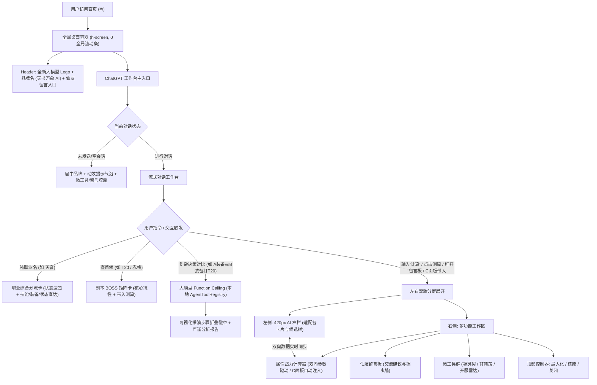

# 实现计划：天书万象 AI 全知大模型战术工作台与双轨分屏架构重构

本计划旨在将现有的静态首页全面重塑为类似 **ChatGPT** 风格的原生大模型战术工作台，确立【天书万象 AI · 诛仙全知大模型】的品牌体系与专属 Logo，实现左侧 420px 窄栏 AI 对话与右侧宽幅多功能工作区（含战力计算器、微工具群、仙友留言板）的平滑分屏联动，彻底消除最右侧垂直滚动条，建立职业意图分流与三大核心卡片体系，并为真正接入大模型（DeepSeek / Workers AI）预备标准化 Function Calling 本地计算与推演架构。

---

## 一、目标与决策收敛

1. **大模型品牌命名与 Logo 换新（天书主线）**：
   - **主标**：`天书万象 AI · 诛仙全知大模型`（以“全知”取代“战术”，契合天书洞悉三界万象天机）；
   - **副标 / Slogan**：`天地不仁以万物为刍狗 · 天书通晓诛仙万象规则`；
   - **英文子域名前缀**：**`tianshu`** (`tianshu.xxx.com`)，备用 `wanxiang`；
   - **Logo 意象**：外圈为八卦太极道印能量星轨，内芯为几何展开的青色竹简神经元光束；
   - 更新网站 Title、Header 品牌标头与浏览器 Favicon。
2. **消除全视口最右侧滚动条**：
   - 全局容器高度锁定为 `h-screen h-[100dvh] overflow-hidden`，滚动仅在局部面板内部产生，实现桌面客户端级极简沉浸视效。
3. **纯粹 ChatGPT 风格大模型首页**：
   - 彻底移除旧有搜索跳转浮层、热门搜索和搜索历史；
   - 首页初始呈现居中大模型品牌 + 动效使用展示气泡（输入昭武/输入技能/输入计算）+ 快捷微工具胶囊（开服检测/轩辕策/神级天缘/凝灵契/仙友留言板）；
   - 输入后平滑转入全屏或分屏流式对话态。
4. **双轨分屏与右侧工作区 (Split-Screen Workspace)**：
   - 输入“计算”或点击测算时，页面分屏为：左侧 420px AI 对话栏 + 右侧宽幅属性战力计算器；
   - 右侧工作区支持【最大化 (100%宽)】、【还原分屏】、【关闭】；
   - 支持自然语言双向驱动（如左侧对话输入“气血改400万，切T20”，右侧计算器实时同步刷新）；
   - C 界面识图打桩测算点击“带入推演”不再跳页，直接在右侧分屏滑开计算器并注入攻防血蓝数值。
5. **仙友留言板与战术反馈墙 (Guestbook)**：
   - 在右侧多功能工作区直接集成留言反馈面板，无需跳出页面即可边聊边看边反馈；
   - 包含分类筛选（功能建议/数值捉虫/副本交流/催更）、仙门法号随机生成、门派标签、点赞（“仙友所言极是”）与官方回复状态标记。
6. **意图分流与三大卡片接入**：
   - 纯职业词（如【天音】）触发「职业综合分流卡」，展示核心状态摘要 + 4 个直达按钮；
   - 副本/BOSS词（如【T20】、【赤梭】）触发「副本 BOSS 矩阵卡」，提供总气血、条数、减爆伤徽章与【带入测算】；
   - 接入微工具实验室与凝灵契模拟器；
   - 攻略知识库随版本逐步扩展。
7. **大模型 Function Calling 与计算引擎架构（下一步重点）**：
   - 前端构建标准化 `AgentToolRegistry`（与项目已有的 `agent_tool/` 规范一致）；
   - 大模型调用本地 Tools 进行无幻觉确定性计算（如装备 A vs B 真实伤害差值）；
   - 对话流上方可视化呈现折叠推演步骤徽章，零后端维护成本，运行于 Cloudflare Pages。
8. **已判决后续规划项**：
   - 随机概率顶级属性（轩辕策、神机、天缘、凝灵契、宠物刻誓）的识图极品度差异对比算法（后续专项）；
   - 神机属性白/绿/蓝/紫/橙/红 6 色品质还原（后续神机模拟器中带入）；
   - 移动端微信小程序（暂时搁置，PC 桌面版稳定后再行启动）。

---

## 二、架构设计图



---

## 三、文件变更清单与代码设计

### 1. 品牌与 Logo 换新 (Branding Layer)

#### [MODIFY] [Header.tsx](file:///D:/工作/ww/personal_work/new_zx_calc_noactcode_agent/web_app/src/components/layout/Header.tsx)
- 品牌名更新为 `天书万象 AI`（副标：`诛仙全知大模型`）；
- 嵌入全新的八卦太极天书神经元光束矢量 Logo；
- 导航右侧常驻 `[ 仙友留言 ]` 按钮，点击即可分屏拉起右侧留言板工作台。

#### [MODIFY] [index.html](file:///D:/工作/ww/personal_work/new_zx_calc_noactcode_agent/web_app/index.html)
- 更新页面 `<title>` 为 `天书万象 AI · 诛仙全知大模型 | 天地不仁以万物为刍狗`；
- 升级 Meta 描述与 Favicon 图标。

---

### 2. 全局视口容器与滚动条治理 (Shell Layer)

#### [MODIFY] [App.tsx](file:///D:/工作/ww/personal_work/new_zx_calc_noactcode_agent/web_app/src/App.tsx)
- 将外层根 `div` 样式由原本的 `min-h-screen overflow-x-hidden` 调整为 `h-screen h-[100dvh] overflow-hidden flex flex-col`；
- `<main>` 容器设为 `flex-1 min-h-0 w-full overflow-hidden flex flex-col`；
- 紧凑化页脚，避免侵占主视口高度；
- 彻底根除浏览器 `window` 顶层最右侧的垂直滚动条，实现桌面客户端级体验。

---

### 3. 纯粹 ChatGPT 首页工作台 (Home Layer)

#### [MODIFY] [HomePage.tsx](file:///D:/工作/ww/personal_work/new_zx_calc_noactcode_agent/web_app/src/components/home/HomePage.tsx)
- 移除旧有的下拉搜索浮层、搜索历史记录、热门搜索词区域以及静态卡片群；
- 重塑初始未对话状态（Landing State）：
  - 现代化居中品牌与 Slogan（`天地不仁以万物为刍狗 · 天书通晓诛仙万象规则`）；
  - 动态功能展示提示气泡：`[ 昭武装备 ]`、`[ 门派技能 ]`、`[ 伤害计算 ]`（点击直接发送体验）；
  - 微工具快捷入口胶囊：`[ 开服检测 ]`、`[ 轩辕策洗练 ]`、`[ 神级天缘 ]`、`[ 凝灵契模拟 ]`、`[ 仙友留言板 ]`；
  - 大模型高保真对话输入框（支持文字、回车发送、图片上传、Ctrl+V 截图粘贴打桩）；
- 挂载双轨分屏控制器状态 `isSplitWorkspaceOpen` 与 `workspaceMode ('calc' | 'guestbook' | 'xyc' | 'server' | 'ninglingqi')`。

---

### 4. 双轨分屏工作区与数据双向联动 (Split-Screen Layer)

#### [NEW] [SplitScreenWorkspace.tsx](file:///D:/工作/ww/personal_work/new_zx_calc_noactcode_agent/web_app/src/components/workspace/SplitScreenWorkspace.tsx)
- 负责承载右侧多功能工作区，支持三种视窗模式：
  - `split`（分屏态：左侧 420px，右侧占满剩余宽度）；
  - `maximized`（最大化：右侧铺满 100% 视口）；
  - `closed`（收起：右侧平滑收回，左侧居中全屏）。
- 顶部常驻控制器：
  - 当前工作台标题切换与模式徽章；
  - 视窗控制按钮：最大化、还原分屏、关闭按钮；
- 内部动态挂载：
  - 战力计算器全套：`AttributePanel` + `BuffPanel` + `ResultSection`；
  - 仙友留言板：`GuestbookPanel`；
  - 各类微工具：`ServerRadarView`、`XycSimulatorView`、`NewTianYuanSimulatorView`、`NingLingQiSimulatorView`。

#### [NEW] [GuestbookPanel.tsx](file:///D:/工作/ww/personal_work/new_zx_calc_noactcode_agent/web_app/src/components/workspace/GuestbookPanel.tsx)
- 仙友留言板面板组件：
  - 分类筛选：全部、功能建议、数值捉虫、副本交流、催更；
  - 仙门法号随机生成器与门派标签；
  - 留言卡片流、点赞数（“仙友所言极是”）、置顶公告、官方处理状态（已采纳/已排期/已修复）。

#### [MODIFY] [HomeAIChatStage.tsx](file:///D:/工作/ww/personal_work/new_zx_calc_noactcode_agent/web_app/src/components/home/HomeAIChatStage.tsx)
- 在分屏模式下将对话流容器宽度自适应为 420px；
- 重点优化 420px 下所有装备卡片、技能卡片、候选栏 `CandidateSelectorBar` 的流式布局，保证不出现水平截断或横向错乱；
- 卡片右上角增加【在右侧联动计算器打开】按钮；
- C 面板诊断卡片中的“带入推演”改造为：调用分屏开启并注入数值，不跳页。

---

### 5. 意图分流与三大卡片体系 (Intelligence & Card Layer)

#### [MODIFY] [CopilotService.ts](file:///D:/工作/ww/personal_work/new_zx_calc_noactcode_agent/web_app/src/services/CopilotService.ts)
- **纯职业词拦截分流**：
  识别到 `query` 仅为单职业词（如 `天音`、`青云`、`逐霜`）时，拦截默认的宽泛装备搜索，生成 `class_hub` 分流卡片。
- **计算与参数修改指令解析（双向联动）**：
  识别“计算”、“测伤”、“气血改400万”、“切换T20”等指令，触发分屏打开并调度 `AppContext` 对应方法。
- **副本 BOSS 意图扩展**：
  扩展对 `T16~T21`、`兽神困难`、`空桑`、`天帝`、`流波` 等代号匹配，支持副本下一键索引 BOSS 矩阵。

#### [NEW] [ClassHubCard.tsx](file:///D:/工作/ww/personal_work/new_zx_calc_noactcode_agent/web_app/src/components/compendium/ClassHubCard.tsx)
- 展示职业名称、推荐阵营、定位标签（S+ 辅助等）；
- 核心状态精简面板：易伤、破防、专注（群体/自身）、保命机制标签；
- 4 个一键直达交互胶囊：
  1. `[ 职业技能速查 ]`
  2. `[ 专属武器装备 ]`
  3. `[ 完整状态详情 ]`
  4. `[ 极致属性攻略 ]`

#### [NEW] [BossMatrixCard.tsx](file:///D:/工作/ww/personal_work/new_zx_calc_noactcode_agent/web_app/src/components/compendium/BossMatrixCard.tsx)
- 呈现首领名称、副本关卡、核心减爆伤抗性徽章；
- 结构化抗性矩阵：总气血、条数、防御、减暴击、减爆伤、伤害压缩、技能躲闪等；
- 右上角配备【带入测算】按钮，一键在右侧分屏展开计算器并载入数据。

---

### 6. 凝灵契模拟器接入 (Tools Layer)

#### [NEW] [NingLingQiSimulatorView.tsx](file:///D:/工作/ww/personal_work/new_zx_calc_noactcode_agent/web_app/src/components/tools/NingLingQiSimulatorView.tsx)
- 借鉴 `zx.res111.com/ninglingqi.html` 的数值与交互模型；
- 还原游戏内凝灵契的属性网格、属性锁定、数值波动、品质完美度、秘效激活条件以及凝灵材料消耗推算；
- 支持独立路由与右侧工作区分屏呼出。

---

### 7. 大模型 Function Calling 运行时实现 (Next-Step Focus)

#### [NEW] [AgentToolRegistry.ts](file:///D:/工作/ww/personal_work/new_zx_calc_noactcode_agent/web_app/src/services/AgentToolRegistry.ts)
- 封装标准 Tools JSON Schema 清单：
  - `lookup_equip_stats`
  - `lookup_boss_resistance`
  - `simulate_gear_comparison`
  - `evaluate_marginal_gain`
- 挂载执行器：调用 `@zx/simulation-engine` 零网络延迟输出对比矩阵。

#### [NEW] [ReasoningStepAccordion.tsx](file:///D:/工作/ww/personal_work/new_zx_calc_noactcode_agent/web_app/src/components/chat/ReasoningStepAccordion.tsx)
- 战术推演步骤动态折叠手风琴徽章，展示工具调用证据。

---

## 四、验证计划

### 1. 自动化构建与类型校验
```bash
cd web_app
npm run build
```
确保 `tsc -b && vite build` 0 报错、0 警告。

### 2. 手工交互验证清单
1. **天书万象品牌与 Logo 验证**：
   - 验证网页标题、Header 品牌名称与全新天书太极神经元 Logo 正常显示；
   - 点击顶栏【仙友留言】按钮，验证能否在右侧工作区滑出留言板。
2. **视口滚动条验证**：
   - 访问首页、计算器、资料库各子页；
   - 验证浏览器最右侧窗口无任何垂直滚动条；
   - 对话流、计算器内部内容过多时，仅在容器内部正常滚动。
3. **纯粹大模型首页验证**：
   - 打开首页，验证旧搜索浮层、热门速搜已消失；
   - 点击“输入昭武”、“输入技能”、“输入计算”动效气泡，验证是否能正常激发对应卡片或动效；
   - 点击微工具药丸【仙友留言板】，验证右侧滑出留言墙。
4. **职业分流验证**：
   - 输入【天音】：验证返回紧凑「职业综合分流卡」，展示 S+ 辅助、30% 易伤、100 破防、20 专注及 4 个直达按钮；
   - 点击【职业技能速查】，验证无缝切换出天音技能候选与 1:1 原生卡片。
5. **分屏工作区与双向联动验证**：
   - 输入“计算”或点击任意 BOSS 卡片右上角【带入测算】；
   - 验证页面平滑分屏，左侧 420px 宽度正常展示卡片无溢出，右侧工作区完整加载计算器；
   - 测试右侧工作区【最大化】、【还原分屏】、【关闭】操作；
   - 在左侧输入“气血修改为400万”，验证右侧计算器气血输入框实时更新为 4000000 并重测秒伤；
   - 贴图识图 C 面板，点击“带入推演”，验证右侧分屏滑开并注入数值。
