# 诛仙3 天书万象 AI 全知大模型战术工作台与双轨工作区设计方案

> 文档版本：V1.4  
> 日期：2026-10-14  
> 状态：方案设计与落地方案（全架构与 Function Calling 运行时设计）  
> 对应模块：品牌命名与Logo（天书万象·全知大模型）、首页交互演进、大模型分流、双轨分屏工作区、战力联动计算器、微工具实验室、仙友留言板、大模型 Function Calling 与 Cloudflare 运行时架构

---

## 一、背景与设计理念

随着项目已全量接入 5,927 个技能原生视图、神隐/修武/昭武/彰武全系装备、以及 97 个副本的完整 BOSS 抗性体系，原有的“搜索框 + 页面跳转”模式已无法承载高阶玩家对于“即问即得、即改即测”的战术推演需求。

本次重构旨在将首页彻底演进为类似 **ChatGPT** 风格的原生大模型战术工作台，实现以下核心蜕变：
1. **天书灵魂品牌与 Logo**：深度契合原著【天书五卷】与【天地不仁，以万物为刍狗】的核心哲学，确立专属中文名【天书万象 AI】、定位【诛仙全知大模型】与子域名前缀【`tianshu`】。
2. **纯粹大模型体验**：剔除旧有的搜索跳转浮层、搜索历史与静态外框，打开即为现代化 AI 对话工作台。
3. **意图智能分流**：解决单职业名称（如输入【天音】）的意图歧义，通过「职业综合分流卡」与快捷选项实现 0ms 精准引导。
4. **双轨分屏联动**：输入“计算”或点击测算时，页面平滑动效分屏（左侧 420px AI 窄栏，右侧为宽幅属性战力计算器），AI 指令可直接双向实时修改右侧面板。
5. **C 面板识图无缝入算**：C 界面面板识图报告点击“带入推演”不再跳页，直接在当前页面右侧滑出分屏计算器并将 OCR 攻防血蓝数值注入。
6. **仙友留言板深度集成**：右侧多功能工作区支持直接滑出留言反馈墙，支持边问 AI 边提建议、战术讨论与捉虫交流。
7. **大模型 Function Calling 运行时**：大模型当“大脑”，本地数据与计算引擎当“手和尺”，在 Cloudflare 上以纯前端零成本方式运行复杂装备对比与伤害推演。
8. **桌面级纯净容器**：视口高度锁定为 100vh，全局消除浏览器最右侧的垂直滚动条，滚动完全内敛于局部工作区中。

---

## 二、大模型品牌命名与 Logo 方案

### 1. 品牌标语体系 (Slogan)
- **主标**：`天书万象 AI · 诛仙全知大模型`
  - *定位诠释*：“全知”境界超越单一战术工具，暗合原著中天书洞悉三界五行万法的至高法则，契合系统对全量 5,927 技能、全系装备、97 副本抗性与机制无所不知的知识图谱能力。
- **副标 / Slogan**：`天地不仁以万物为刍狗 · 天书通晓诛仙万象规则`
  - *哲学出处*：天书第一卷开卷名句。数值与机制不偏不倚，客观推演万象生克。
- **英文名 / 二级子域名前缀**：**`tianshu`** (`tianshu.xxx.com`)，备用别名 `wanxiang`。

### 2. Logo 视觉设计
- **图形结构**：
  - 外圈为八卦太极道印能量星轨（象征天地不仁的宇宙法则）；
  - 内芯为几何展开的青色竹简神经元光束（象征天书古卷与现代 AI 神经节点的交织）。
- **色彩体系**：深邃墨夜（`#0b0f17`）底色 + 玄青灵光（`#22d3ee`） + 浅金道芒（`#fbbf24`）。
- **网页标题 Title**：`天书万象 AI · 诛仙全知大模型 | 天地不仁以万物为刍狗`。

---

## 三、四大核心架构与详细设计

### 1. 首页工作台与初始动效（ChatGPT 范式）

#### (1) 移除旧元素
- 彻底屏蔽/下线原首页的下拉搜索跳转浮层、热门搜索标签、本地搜索历史记录；
- 移除外层多余的静态展示卡片与层叠外框，使首屏聚焦于对话中心。

#### (2) 初始未对话状态（Landing State）
- **居中天书品牌**：呈现全新 Logo + `天书万象 AI · 诛仙全知大模型` + `天地不仁以万物为刍狗 · 天书通晓诛仙万象规则`；
- **动态交互提示气泡（Click-to-Experience）**：
  - `[ 输入昭武 ]`：展示全职业神隐/昭武/彰武装备卡与升降阶推演；
  - `[ 输入技能 ]`：展示 1:1 游戏原生技能卡与等级升降阶视图；
  - `[ 输入计算 ]`：即刻分屏呼出右侧战斗力与伤害推演计算器。
- **快捷微工具药丸（Tool Pills）**：
  在输入框下方整齐排列高频微工具入口：
  - `[ 开服检测 ]` · `[ 轩辕策洗练 ]` · `[ 神级天缘 ]` · `[ 凝灵契模拟 ]` · `[ 仙友留言板 ]`
  点击后即可在右侧工作区滑出对应模拟器或留言墙。
- **现代化输入容器**：
  - 支持文本输入、回车发送、Ctrl+K 快捷聚焦；
  - 深度支持图片拖拽与 Ctrl+V 截图直接粘贴（识图打桩与 C 面板诊断）。

#### (3) 对话流展开态（Chat Stream）
- 用户发送指令后，界面平滑过渡至上下流式滚动对话区；
- 顶部保留极简工具条：提供【新对话】、【清空】以及【右侧工作台开关】。

---

### 2. 双轨分屏与右侧多功能工作区架构 (Split-Screen Workspace)

#### (1) 布局尺寸与响应式策略
- **默认全屏态**：用户纯聊天、查技能、查装备时，AI 对话流居中全宽展示（最大宽度 960px，经典 ChatGPT 视效）；
- **分屏联动态**：当用户输入“计算”/“测算”、点击卡片上的【带入测算】按钮、或 C 面板识图后点击【带入推演】时，触发丝滑 CSS 过渡动效展开右侧工作区：
  - **左侧 AI 栏**：自适应固定宽度 **420px**，内嵌定制滚动条，各类装备卡、技能卡与候选栏针对 420px 宽度进行高保真流式适配，严防横向溢出；
  - **右侧工作区**：占据剩余宽度，完整呈现多功能工作台；
- **控制器（Header Controls）**：
  - `[ 最大化 ]`：工作区铺满 100% 宽度，暂时隐藏左侧对话栏；
  - `[ 还原分屏 ]`：恢复左侧 420px + 右侧宽幅视图；
  - `[ 关闭 ]`：右侧工作区平滑滑出收起，左侧恢复居中全屏对话态。

#### (2) 双向数据驱动机制（Bidirectional Sync）
- **AI 驱动右侧计算器**：
  当用户在左侧输入自然语言指令（例如“将大攻修改为20万，气血改400万，目标换成T20”）：
  - 本地意图解析器提取数值槽位并直接调用 `AppContext` 的 `updateCharacterAttributes` 与 `updateSelectedBoss`；
  - 右侧计算器各输入框实时跳动高亮并完成重新计算；
  - 左侧 AI 返回轻量反馈确认气泡：“已为您将气血调整为 4,000,000，目标首领切换至【镇海断浪·T20】”。
- **C 面板识图注入**：
  在左侧识别 C 面板截图后，点击【带入推演】不再跳页，直接在右侧分屏滑开计算器，并将大攻、防御、气血、真气、暴击、暴伤、减免、怪增等数值一次性注入右侧输入框。
- **右侧计算器反哺 AI**：
  用户在右侧微调数值后，点击【生成诊断报告】可将最新战力指标推入左侧对话流中作为上下文。

#### (3) 多功能工作台内容聚合
右侧工作区支持动态切换承载以下模块：
1. **属性战力推演计算器**：包含属性录入、战斗增益勾选、T20/T21/团本秒伤实时测算。
2. **仙友留言与反馈墙 (Guestbook)**：仙友交流、战术心得、Bug 捉虫与更新公告。
3. **开服雷达监测**：维护日毫秒级声光提醒。
4. **轩辕策四象模拟器**：青龙/白虎/朱雀/玄武品相与 1~20 阶推演。
5. **新版天缘模拟器**：须弥装备天缘属性理论极限推演。
6. **凝灵契模拟器**：借鉴 zx.res111.com/ninglingqi.html，还原游戏内凝灵契的属性列表、锁定、升降数值、品相度及消耗推演。

---

### 3. 仙友留言板与反馈墙设计 (Guestbook Architecture)

#### (1) 入口布局
- **Header 顶栏常驻入口**：顶栏右侧新增精致留言气泡按钮 `[ 仙友留言 ]`；
- **首页快捷药丸**：输入框下方常驻 `[ 仙友留言板 ]` 胶囊；
- **右侧工作区分屏呈现**：点击任意入口，无需刷新跳页，直接在右侧工作区滑出「仙友留言板」，左侧 AI 对话流依然保持可用。

#### (2) 核心交互功能
- **分类标签 (Categories)**：
  - `[ 全部 ]` · `[ 功能建议 ]` · `[ 数值捉虫 ]` · `[ 副本配装交流 ]` · `[ 催更新功能 ]`
- **留言发布表单 (Post Form)**：
  - **仙门法号**：支持自定义昵称，或提供随机仙门法号生成器（如“玉清散人”、“青云九叶”、“焚香老祖”）；
  - **宗门/大区**：选填门派（如天音、逐霜）与所在大区（如三界天、飞升服）；
  - **留言内容**：富文本输入框，支持一键引入当前 AI 对话中的属性卡片或截图快照；
- **列表互动 (Interactive List)**：
  - 精选/作者置顶区：官方公告、版本排期、已采纳需求答复；
  - 留言卡片：展示仙门法号、时间、门派徽章、留言内容与点赞数（“仙友所言极是”）；
  - 状态标记：官方回复后显示显眼的彩色徽章（如 `已采纳`、`排期中`、`已在最新版本修复`）。
- **数据持久化方案**：
  - 采用轻量且高可靠的 Serverless 存储（如 Cloudflare KV/D1 或 GitHub Discussions API 代理），零本地数据库运维成本，保障全国毫秒级读取。

---

### 4. 意图分流与三大核心卡片体系

#### (1) 纯职业单字词歧义治理（以输入【天音】为例）
当用户仅输入单一职业名称时，系统返回**「职业综合分流卡 (Class Hub Card)」**：
- **卡片头部**：职业名称【天音】、阵营推荐【佛】、定位徽章【团队核心辅助 · S+】；
- **第一层：核心状态摘要**：
  - 易伤：`30%`
  - 破防：`100`
  - 专注：`20 (群体专注)`
  - 机制标签：`[救人]` `[免控]` `[免死]` `[解控]` `[减伤]` `[血槽]`
- **第二层：四大一键分流交互药丸**：
  - `[ 职业技能速查 ]`：在左侧唤出天音 30+ 核心技能候选列表与 1:1 卡片；
  - `[ 专属武器装备 ]`：在左侧唤出天音修武/昭武/彰武杖及神级首饰；
  - `[ 完整状态详情 ]`：唤出该职业详细的战斗增益分析；
  - `[ 极致减免攻略 ]`：唤出该职业极限防御/躲闪属性指南。
- **带修饰词自动直达**：若输入 `天音技能`、`天音装备`、`天音状态`，则 0ms 跳过分流卡直接打开对应垂直卡片。

#### (2) 副本 BOSS 属性与测算卡片
- **触发词**：副本名/代号（`T20`、`兽神困难`、`空桑`、`天帝3`、`流波`、`四象七`、`悬夜林`）或 BOSS 名（`赤梭`、`句芒`、`饕餮`）；
- **卡片结构**：
  - 首行：BOSS 名 + 副本名 + 关卡 + 核心【减爆伤抗性徽章】；
  - 属性矩阵：总气血、条数、防御、减暴击、减爆伤、伤害压缩、技能躲闪等；
  - 联动按钮：右上角【带入测算】按钮，点击立即在右侧工作区滑出计算器并载入该首领。

#### (3) 极致属性攻略卡片与攻略库渐进演进
- **基础触发**：`极致属性`、`极致无视`、`极致减免`、`极致减暴击`、`极致怪增`、`极致躲闪`；
- **卡片结构**：提供二级切换面板，清晰展示全服理论上限、门槛线、毕业线及分系统来源拆解；
- **攻略库扩展路线**：后续逐步引入副本走位机制破除、职业加点推荐等图文数据，转化为 AI 问答结构化知识卡片。

---

### 5. 全局桌面级无滚动条布局架构 (Zero-Scrollbar Desktop Shell)

#### (1) 痛点剖析
目前页面最右侧出现全屏垂直滚动条的原因在于根容器采用了 `min-h-screen flex flex-col`，叠加顶部 Header、底部 Footer 以及主视口内容的高度总和超出 100vh，导致浏览器顶层 `<html>`/`<body>` 强制生成默认垂直滚动条。

#### (2) 优化落地方案
- **视口高度锁定**：
  在 `App.tsx` 中将应用外层容器修改为：
  ```tsx
  <div className="h-screen h-[100dvh] overflow-hidden flex flex-col bg-slate-950 zx-ink-bg">
    <Header />
    <main className="flex-1 min-h-0 w-full overflow-hidden flex flex-col">
      {/* 页面内容在内部受控滚动 */}
    </main>
  </div>
  ```
- **内敛式局部滚动**：
  - 浏览器窗口绝对不出现最右侧系统滚动条；
  - 仅在需要滚动的局部区域（如 AI 聊天对话流、右侧工作台、图鉴列表）应用自定义的细滚动条或隐藏滚动条（`no-scrollbar`），获得桌面客户端般的沉浸感；
- **Footer 紧凑化重构**：
  将原本占据较大垂直高度的独立页脚，优化为融入右侧工作区底栏或左侧对话框底部的单行微型状态条（展示版本、延迟、离线数据状态）。

---

## 四、大模型海量数据驱动与 Function Calling 运行时架构（下一步实施重点）

### 1. 痛点：为什么不能直接把全量数据“塞给”大模型？
- **幻觉与算力失效**：大模型擅长“语言理解、逻辑归纳与战术建议”，但不擅长精确的心算（如诛仙非线性的减爆伤折减、易伤独立乘区、伤害压缩百分比等）。直接让模型硬猜公式必然产生严重幻觉。
- **Token 爆炸与延迟灾难**：全量 5,927 个技能、数百件装备、97 个副本的完整抗性数据如果每次塞进 Prompt 上下文，单次对话需要消耗数万 Token，超出免费 RPM 限制且响应极其迟缓。
- **解题核心方法论**：
  **“大模型当大脑，本地数据与计算引擎当手和尺”**。
  大模型只负责理解玩家的意图并下发计算需求，实际的数据抓取与伤害差值计算由本地精确执行，再将结果喂回大模型输出严谨报告。

---

### 2. 标准化 AgentToolRegistry（工具注册中心）设计
在前端构建一套与项目中 `agent_tool/` 规范对齐的标准 Tools JSON Schema，供 DeepSeek / Workers AI / OpenAI 接口标准调用：

```typescript
export interface AgentToolDefinition {
    name: string;
    description: string;
    parameters: {
        type: 'object';
        properties: Record<string, any>;
        required: string[];
    };
}
```

#### 核心注册工具库清单：
1. **`lookup_equip_stats`**：
   - *入参*：`{ name: string, level?: number, refLevel?: number }`
   - *功能*：0ms 精确调取指定装备的基础属性、蕴灵加成与神机档位数值。
2. **`lookup_boss_resistance`**：
   - *入参*：`{ dungeonName: string, bossName?: string }`
   - *功能*：获取该副本所有首领的精确减爆伤、减暴击、防御、伤害压缩等真实抗性。
3. **`simulate_gear_comparison` (装备对比核心工具)**：
   - *入参*：
     ```json
     {
       "characterClass": "天音",
       "faction": "FO",
       "baseAttributes": { "critDamage": 2200, "attack": 250000 },
       "bossTarget": "T20",
       "gearA": { "name": "天弈印记", "level": 1 },
       "gearB": { "name": "煌武项链", "level": 3 }
     }
     ```
   - *执行逻辑*：前端直接调用 `@zx/simulation-engine` 跑出两套配置在 T20 下的真实秒伤，输出数据对比矩阵（如：“装备 A 秒伤 1.35 亿，装备 B 秒伤 1.28 亿，A 提升 +5.47%”）。
4. **`evaluate_marginal_gain` (属性边际收益分析)**：
   - *功能*：计算在当前面板与目标副本下，100 爆伤 vs 5000 大攻 vs 5% 无视减免哪项收益更高。

---

### 3. Cloudflare Pages 上的端到端运行时工作流

整个全栈完全运行在 **Cloudflare Pages** 静态托管环境，**零服务器后端运维成本、零外部传输延迟**：

```mermaid
sequenceDiagram
    autonumber
    actor User as 仙友 (浏览器)
    participant UI as 前端对话界面 (tianshu.xxx.com)
    participant LLM as 大模型 (DeepSeek / Workers AI)
    participant Registry as AgentToolRegistry (前端本地)
    participant Engine as @zx/simulation-engine (前端本地)

    User->>UI: 提问：“我是佛天音，当前2200爆伤，带天弈印记还是煌武三星打T20好？”
    UI->>LLM: 发送提问 + tools声明清单 (不带庞大数据，极轻量)
    LLM-->>UI: 触发 tool_calls: simulate_gear_comparison(天弈印记 vs 煌武项链, T20)
    
    rect rgb(20, 30, 45)
        Note over UI,Engine: 前端本地推演过程 (可视化展开折叠徽章)
        UI->>Registry: 执行本地工具 simulate_gear_comparison
        Registry->>Engine: 输入装备参数与 Boss 抗性运行确定性公式
        Engine-->>Registry: 返回精准输出 (A: 1.35亿, B: 1.28亿, 差异+5.47%)
        Registry-->>UI: 完成工具执行
    end
    
    UI->>LLM: 回传 tool_call 结果 (精确数据矩阵)
    LLM-->>UI: 组装专业仙侠风格、数据确凿的战术分析报告
    UI-->>User: 渲染报告卡片，并顶部附带“已展开战术推演步骤”折叠证据
```



#### 用户体验设计：推演过程可视化徽章
在 AI 输出回答前与卡片上方，呈现类似 DeepSeek / ChatGPT 的动态推演状态：
```
▼ 战术推演过程 (点击收起)
  ✓ 提取【天弈印记】属性：无视减免+6.5%、大攻+1200
  ✓ 提取【煌武项链★★★】属性：暴击伤害+45%、攻击+800
  ✓ 调用【数值模拟引擎】载入【镇海断浪·T20】首领抗性 (减爆伤 1920%)
  ✓ 确定性仿真完成：天弈印记实战秒伤 135,210,000，优于煌武项链 (+5.47%)
```
随后输出大模型自然语言深入剖析，既有大模型的智能与逻辑，又有本地公式的 100% 准确性，彻底根绝胡言乱语。

---

## 五、分阶段演进路线

### 1. 第一阶段：品牌换新、桌面视口与纯净大模型首页（当前立即执行）
- 品牌更名与 Logo 换新（确立【天书万象 AI · 诛仙全知大模型】、`tianshu` 子域名前缀与八卦神经元 Logo）；
- 改造 `App.tsx` 全局视口为 `h-screen overflow-hidden`，彻底消除最右侧垂直滚动条；
- 重构 `HomePage.tsx` 为 ChatGPT 纯净大模型界面，移除旧搜索跳转框，加入动画示例与微工具快捷胶囊；
- C 界面识图打桩测算支持一键分屏拉开计算器注入。

### 2. 第二阶段：双轨分屏工作区与数据双向联动（当前立即执行）
- 实现左侧 420px 窄栏与右侧多功能工作区的平滑分屏动效；
- 接入属性战力计算器的最大化、还原、关闭交互；
- 编写自然语言参数修改联动引擎（如“改气血400万”即时修改右侧面板）。

### 3. 第三阶段：职业分流与三大卡片接入（当前立即执行）
- 接入 `ClassHubCard` 解决【天音】等纯职业词的意图引导；
- 升级 `BossCard` 矩阵视图并提供一键右侧开算能力；
- 接入极致属性攻略卡片。

### 4. 第四阶段：仙友留言板与凝灵契模拟器（当前立即执行）
- 在右侧多功能工作区接入「仙友留言板 (Guestbook)」组件；
- 依据 `zx.res111.com/ninglingqi.html` 规范开发 `NingLingQiSimulatorView`；
- 将开服检测、轩辕策、天缘、凝灵契、仙友留言板统一收口至右侧多功能工作区中。

### 5. 第五阶段：AgentToolRegistry 与大模型深度战术推演（重点实施阶段）
- 构建前端本地 `AgentToolRegistry` 工具库；
- 串联 DeepSeek / Workers AI 的 `tool_calls` 机制；
- 接入推演步骤可视化手风琴，实现类似“装备A vs 装备B 谁打T20伤害更高”的深度全自动推演。

---

## 六、后续迭代专项规划（已判决）

1. **随机/概率顶级属性“极品度差异对比”引擎**（后续专项规划）：
   - 聚焦于通过概率洗练获取顶级属性的五大核心品类：**轩辕策、神机属性、天缘属性、凝灵契、宠物刻誓**；
   - 支持拍照/截图识别后，AI 自动与理论天花板数值进行矩阵级比对，输出 85% / 95% 毕业度评级与缺陷补齐建议；
   - （普通装备因具有确定性蕴灵与固定成长规则，不纳入差异度对比）。
2. **神机属性品质分色还原**（在后续神机属性模拟器小工具中实现）：
   - 在专门的神机属性洗练模拟器中，精准还原游戏原版白、绿、蓝、紫、橙、红六阶品质分色与档位概率。
3. **攻略知识库逐步扩展**：
   - 随版本迭代持续收录副本走位机制破除、职业加点推荐等图文数据，转化为 AI 问答结构化知识卡片。
4. **移动端 / 微信小程序适配**：
   - 暂且搁置，待 PC 桌面端核心交互完全定型后择期启动。
